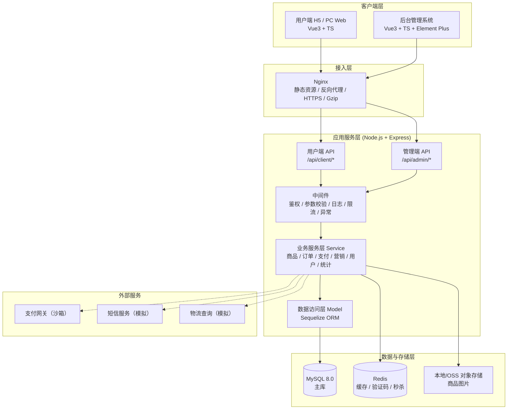
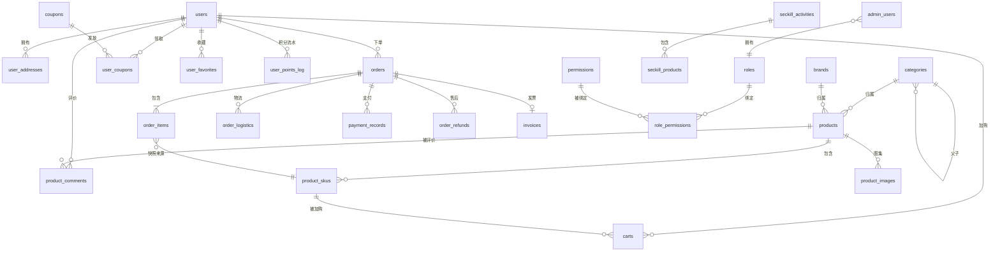

# 小兔鲜电商平台 · 开发企划书

| 项目名称 | 小兔鲜电商（XiaoTuXian Mall） |
| --- | --- |
| 文档版本 | v1.0 |
| 编制日期 | 2026-09-20 |
| 文档状态 | 待评审 |
| 团队规模 | 3–5 人小团队（基准 4 人：前端 2 + 后端 2） |
| 计划周期 | 12 周（约 3 个月），含 1 周缓冲 |
| 经营模式 | 平台自营（B2C 单商户），重点：商品管理 + 订单管理 |

---

## 目录

- [一、项目概述](#一项目概述)
- [二、总体技术方案](#二总体技术方案)
- [三、功能需求规格说明](#三功能需求规格说明)
- [四、数据库设计](#四数据库设计)
- [五、接口设计规范（API）](#五接口设计规范api)
- [六、工程化与代码规范](#六工程化与代码规范)
- [七、开发排期与里程碑](#七开发排期与里程碑)
- [八、团队分工与协作机制](#八团队分工与协作机制)
- [九、测试与质量保障](#九测试与质量保障)
- [十、部署、运维与上线](#十部署运维与上线)
- [十一、风险识别与应对](#十一风险识别与应对)
- [十二、附录](#十二附录)

---

## 一、项目概述

### 1.1 项目背景

小兔鲜是一个**平台自营式 B2C 电商系统**。与多商户平台（B2B2C）不同，本平台所有商品由平台方统一采购、统一定价、统一发货，因此**不存在商家入驻、店铺管理、平台抽佣结算**等复杂模块，业务链路更聚焦：**商品 → 购物车 → 订单 → 支付 → 发货 → 售后**。

这一模式决定了系统的两个核心：

1. **商品管理**是整个系统的基础数据源，其数据模型（SPU/SKU/规格/库存）的质量直接决定订单、营销、统计模块能否落地；
2. **订单管理**是业务流转的中枢，订单状态机串联了库存、支付、物流、售后、财务五条线。

### 1.2 项目定位与目标

**业务目标**

- 交付一套功能完整、可真实下单支付的电商闭环系统；
- 覆盖现代电商平台的主流功能面（用户端 6 大模块 + 后台 6 大模块）；
- 形成可复用的电商中台能力（商品中心、订单中心、营销中心）。

**技术目标**

- 实践「Vue3 + TypeScript + Vite」现代前端工程化范式；
- 实践「Node.js + Express + Sequelize + MySQL」前后端分离的后端服务分层架构；
- 建立一套完整的团队协作工程规范（Git 工作流、接口契约、代码门禁、CI/CD）。

### 1.3 项目范围

| 范围 | 内容 |
| --- | --- |
| **本期做（In Scope）** | 用户端全流程、后台管理系统全模块、自营单商户模式、模拟/沙箱支付、单机部署 |
| **本期不做（Out of Scope）** | 多商户入驻与店铺体系、平台抽佣与商家结算、直播带货、社区团购、自研 IM 客服（用第三方或留言替代）、真实资金清结算（仅做流水记录）、跨境与多币种 |

### 1.4 关键成功指标（KPI）

| 指标 | 目标值 |
| --- | --- |
| 核心链路可用性 | 注册 → 浏览 → 加购 → 下单 → 支付 → 查看订单，全链路无阻断 |
| 首屏加载（4G 网络） | 用户端首页 < 2.5s |
| 接口平均响应 | P95 < 300ms |
| 单元/接口测试覆盖 | 后端核心 service 层 ≥ 60% |
| 缺陷收敛 | 上线前 P0/P1 缺陷清零 |
| 交付质量 | 所有页面适配 375px / 768px / 1440px 三档宽度 |

---

## 二、总体技术方案

### 2.1 技术栈总览

| 层次 | 技术选型 | 说明 |
| --- | --- | --- |
| 前端基础 | HTML5 + CSS3 | 语义化标签、Flex/Grid 布局、CSS 变量主题化 |
| 多端适配 | PostCSS + postcss-px-to-viewport / rem 方案 | 移动优先，375/768/1440 三档断点，图片 `srcset` 自适应 |
| 前端逻辑 | JavaScript (ES2020+) | 原生能力（事件、异步、模块化）作为基础 |
| 前端框架 | Vue3（Composition API + `<script setup>`） | 配套 Vue Router 4、Pinia 状态管理 |
| 类型系统 | TypeScript 5.x | `strict` 模式开启，接口 DTO 与后端契约对齐 |
| 网络请求 | AJAX / axios | 统一封装请求拦截、Token 注入、错误码处理 |
| UI 组件 | Element Plus（后台） + 自研/轻量组件（用户端） | 后台求效率，用户端求定制与性能 |
| 后端服务 | Node.js 20 LTS + Express 4 | 分层架构：Router → Controller → Service → Model |
| 数据库 | MySQL 8.0 | InnoDB、utf8mb4、读写分离预留 |
| ORM | Sequelize 6（主推） | 若团队更熟 TypeORM 可替换，见 2.5 |
| 鉴权 | JWT（双 Token：access + refresh） | 用户端与管理端分离签发 |
| 缓存 | Redis（可选，P1） | 会话、验证码、热点商品、秒杀库存预扣 |
| 工程化 | Git + Vite 5（前端） + Webpack（备用/兼容） | Vite 为开发与构建主链路 |
| 接口文档 | OpenAPI 3.0 / Swagger UI | 契约先行，前后端并行开发 |
| 代码质量 | ESLint + Prettier + Husky + lint-staged + commitlint | 提交前门禁 |
| 部署 | Nginx + PM2 + Docker Compose | 见第十章 |

### 2.2 系统架构



### 2.3 前后端分离与协作方式

- **契约先行**：数据库设计评审通过后，先输出 OpenAPI 接口文档，前后端按文档并行开发；
- **Mock 优先**：前端在接口未就绪时，通过 Mock 服务（vite-plugin-mock / MSW）按契约返回模拟数据，不被后端阻塞；
- **联调节奏**：每个 Sprint 最后 2 天为联调窗口，统一走测试环境；
- **错误码统一**：业务错误码由后端统一定义并在文档中维护（见 5.2）。

### 2.4 部署架构（单机起步）

```
公网
 │
 ▼
Nginx (443/80)
 ├── /            → 用户端静态资源 (dist/client)
 ├── /admin/      → 后台静态资源 (dist/admin)
 ├── /uploads/    → 商品图片
 └── /api/        → 反向代理 → Node 服务 (PM2 cluster, 127.0.0.1:3000)
                      │
                      ├── MySQL 8.0 (127.0.0.1:3306)
                      └── Redis (127.0.0.1:6379)
```

使用 Docker Compose 一键拉起 `nginx + node + mysql + redis`，保证开发/测试/生产环境一致。

### 2.5 关键技术选型理由

| 决策点 | 选择 | 理由 | 备选 |
| --- | --- | --- | --- |
| 构建工具 | **Vite** | 冷启动秒级、HMR 快、Vue3 官方推荐；Webpack 作为兼容备选保留配置 | Webpack 5 |
| ORM | **Sequelize** | 生态成熟、中文资料多、迁移工具 `sequelize-cli` 完善、关联查询写法直观 | TypeORM（装饰器风格，团队熟悉 TS 装饰器时可换） |
| 状态管理 | **Pinia** | Vue3 官方推荐，TS 类型推导友好，替代 Vuex | Vuex 4 |
| 鉴权 | **JWT 双 Token** | 无状态、易水平扩展；refresh token 解决过期体验问题 | Session + Redis |
| 支付 | **沙箱/模拟支付网关** | 个人与教学项目无法接入真实商户号，用可插拔的 PaymentAdapter 抽象，未来可平滑替换真实网关 | 真实微信/支付宝 |
| 缓存 | **Redis（P1）** | 秒杀库存扣减、验证码、热点商品缓存必需；P0 阶段可先用内存实现 | 内存 Map |

> **可插拔设计要点**：支付、短信、物流、对象存储均以 `Adapter` 接口抽象，配置切换实现类，避免后期替换时侵入业务代码。

---

## 三、功能需求规格说明

### 3.1 用户端

#### 3.1.1 商品展示

| 编号 | 功能 | 说明 | 优先级 |
| --- | --- | --- | --- |
| U-01 | 首页 | 轮播 Banner、分类导航入口、推荐/热销楼层、秒杀专区、新人专区、公告栏 | P0 |
| U-02 | 商品分类页 | 一/二级分类树导航，点击进入列表 | P0 |
| U-03 | 商品列表页 | 支持分类筛选、品牌筛选、价格区间、销量/价格/上新排序、分页/下拉加载 | P0 |
| U-04 | 商品搜索 | 关键词搜索、搜索历史、热门搜索词、搜索结果排序与筛选 | P0 |
| U-05 | 商品详情页 | 主图轮播+缩略图、SKU 规格选择（颜色/尺码）、实时库存与价格联动、商品参数、图文详情、评价列表、加入购物车/立即购买、收藏、分享 | P0 |
| U-06 | 商品评价 | 查看评价列表（带图、标签、分页）、评分统计（好评率） | P1 |
| U-07 | 猜你喜欢 | 基于浏览足迹/分类的推荐位 | P2 |
| U-08 | 品牌专区 | 品牌列表与品牌商品聚合页 | P2 |

**多端适配要求**：移动端（375px）为基准设计，商品列表双列瀑布流；PC 端（≥1200px）四列网格 + 侧边筛选栏；平板端（768px）三列。

#### 3.1.2 购物车与下单

| 编号 | 功能 | 说明 | 优先级 |
| --- | --- | --- | --- |
| U-10 | 加入购物车 | SKU 维度加购、库存校验、数量累加、加购成功提示 | P0 |
| U-11 | 购物车列表 | 商品列表（图/名/规格/单价/数量/小计）、单选/全选、数量增减、删除、批量删除、失效商品区 | P0 |
| U-12 | 购物车结算 | 选中商品金额汇总、优惠券抵扣预览、运费计算 | P0 |
| U-13 | 收货地址 | 新增/编辑/删除地址、设置默认地址、省市区三级联动、下单页选择地址 | P0 |
| U-14 | 确认订单页 | 商品清单确认、地址确认、发票信息（普票/专票/不开票）、优惠券选择、运费、订单备注、应付金额明细 | P0 |
| U-15 | 提交订单 | 库存二次校验与预占、生成订单号、生成待支付订单、跳转支付 | P0 |
| U-16 | 订单列表 | 全部/待付款/待发货/待收货/已完成/已取消 分页筛选 | P0 |
| U-17 | 订单详情 | 状态、商品明细、金额明细、收货信息、物流轨迹、操作按钮（按状态动态展示） | P0 |
| U-18 | 订单操作 | 取消订单、去支付、提醒发货、确认收货、申请售后、再次购买、删除订单 | P0 |
| U-19 | 物流查询 | 物流单号与轨迹时间轴展示 | P1 |
| U-20 | 超时自动关单 | 待支付订单超 30 分钟自动取消并释放库存（定时任务） | P1 |

#### 3.1.3 支付系统

| 编号 | 功能 | 说明 | 优先级 |
| --- | --- | --- | --- |
| U-30 | 选择支付方式 | 微信支付 / 支付宝 / 余额（模拟）/ 沙箱支付 | P0 |
| U-31 | 发起支付 | 创建支付单、调用支付适配器、返回支付参数/二维码 | P0 |
| U-32 | 支付结果 | 同步回跳 + 异步回调双通道，以异步回调为准更新订单状态 | P0 |
| U-33 | 支付状态查询 | 主动轮询订单支付状态，处理回调丢失场景 | P0 |
| U-34 | 退款 | 售后退款申请 → 后台审核 → 调用退款接口 → 资金原路退回（模拟） | P0 |
| U-35 | 支付流水 | 记录每笔支付的请求/回调报文，便于对账与排障 | P1 |
| U-36 | 余额充值 | 用户端选择金额/渠道 → 创建充值单 → 支付回调入账 → 写余额流水 | P0 |

**关键设计**：支付回调必须做**幂等处理**（以支付单号 + 唯一索引保证），且回调处理与订单状态更新需在同一事务内。

#### 3.1.4 个人中心

| 编号 | 功能 | 说明 | 优先级 |
| --- | --- | --- | --- |
| U-40 | 注册 | 手机号+验证码 / 用户名+密码，密码强度校验 | P0 |
| U-41 | 登录 | 账号密码登录、手机验证码登录、记住我、图形验证码防爆破 | P0 |
| U-42 | 找回密码 | 手机验证码重置密码 | P0 |
| U-43 | 第三方登录 | 微信/QQ 授权登录（预留） | P2 |
| U-44 | 个人资料 | 头像上传、昵称、性别、生日、手机号绑定 | P0 |
| U-45 | 账户安全 | 修改密码、支付密码设置（预留）、登录设备记录 | P1 |
| U-46 | 我的订单 | 复用订单列表（带状态筛选） | P0 |
| U-47 | 我的收藏 | 商品收藏列表、取消收藏、批量管理 | P1 |
| U-48 | 浏览足迹 | 按日期分组展示浏览过的商品 | P1 |
| U-49 | 我的优惠券 | 未使用/已使用/已过期 三态 | P1 |
| U-50 | 我的积分 | 积分余额、积分流水、签到赚积分 | P2 |
| U-51 | 我的评价 | 待评价/已评价列表，发布评价（评分+文字+图片） | P1 |
| U-52 | 售后服务 | 售后申请列表与进度跟踪 | P1 |

#### 3.1.5 营销互动

| 编号 | 功能 | 说明 | 优先级 |
| --- | --- | --- | --- |
| U-60 | 优惠券 | 领券中心、满减券/折扣券、使用门槛、有效期、下单自动匹配最优券 | P0 |
| U-61 | 秒杀/限时购 | 秒杀专区、倒计时、限购数量、库存预扣与防超卖 | P1 |
| U-62 | 满减/满赠 | 满 N 减 M、满赠商品，下单自动计算 | P1 |
| U-63 | 新人专享 | 新人首单立减、新人券包 | P2 |
| U-64 | 积分体系 | 签到、消费得积分、积分抵现 | P2 |
| U-65 | 评价晒单 | 评价有礼（送积分/券） | P2 |
| U-66 | 分享 | 商品/活动分享（生成分享海报或链接） | P2 |

**促销计算原则**：优惠叠加规则必须**先定义后实现**，建议顺序为 `商品原价 → 秒杀价 → 满减 → 优惠券 → 运费`，并在订单中**快照记录**每一档优惠金额，避免后期对不上账。

#### 3.1.6 客户服务

| 编号 | 功能 | 说明 | 优先级 |
| --- | --- | --- | --- |
| U-70 | 在线客服 | 接入第三方客服（或简化为留言工单） | P1 |
| U-71 | 常见问题 FAQ | 分类折叠式 FAQ 列表 | P1 |
| U-72 | 售后申请 | 选择订单商品、售后类型（仅退款/退货退款/换货）、上传凭证、填写原因 | P0 |
| U-73 | 售后进度 | 售后单状态跟踪与后台处理结果展示 | P1 |
| U-74 | 投诉建议 | 提交留言工单，后台可回复 | P2 |

---

### 3.2 后台管理系统

#### 3.2.1 商品管理（**核心模块**）

| 编号 | 功能 | 说明 | 优先级 |
| --- | --- | --- | --- |
| A-01 | 商品列表 | 分页、按名称/分类/状态/价格区间筛选、批量上下架、批量删除 | P0 |
| A-02 | 新增/编辑商品 | SPU 基本信息（名称、卖点、分类、品牌、单位、重量）、主图与图集上传、图文详情富文本 | P0 |
| A-03 | SKU 管理 | 规格组（颜色/尺码）与规格值定义、笛卡尔积批量生成 SKU、逐 SKU 设置价格/库存/编码/图片 | P0 |
| A-04 | 商品上下架 | 单个/批量上架下架，下架后用户端不可见 | P0 |
| A-05 | 分类管理 | 多级分类树增删改、排序、图标、启用/停用 | P0 |
| A-06 | 品牌管理 | 品牌 CRUD、Logo、排序、启用状态 | P1 |
| A-07 | 库存管理 | SKU 库存查询与调整、库存预警阈值、库存变更流水 | P0 |
| A-08 | 商品规格/属性模板 | 可复用的规格与属性模板，减少重复录入 | P1 |
| A-09 | 商品评价管理 | 评价查看、隐藏、回复 | P1 |
| A-10 | 商品导入导出 | Excel 批量导入商品、导出商品清单 | P2 |

#### 3.2.2 订单管理（**核心模块**）

| 编号 | 功能 | 说明 | 优先级 |
| --- | --- | --- | --- |
| A-20 | 订单列表 | 多条件筛选（订单号/用户/状态/时间范围/支付方式）、分页 | P0 |
| A-21 | 订单详情 | 商品明细、金额明细、收货信息、支付信息、操作日志时间轴 | P0 |
| A-22 | 订单发货 | 填写物流公司+运单号、批量发货、修改运单号 | P0 |
| A-23 | 订单状态操作 | 关闭订单、修改价格（P2）、备注、标记异常 | P0 |
| A-24 | 退款/售后处理 | 售后单审核（同意/拒绝+理由）、退款执行、退货收货确认 | P0 |
| A-25 | 订单日志 | 记录所有状态变更的操作人、时间、原因 | P1 |
| A-26 | 订单导出 | 导出 Excel（按筛选条件） | P1 |
| A-27 | 物流配置 | 物流公司字典维护、运费模板 | P1 |

#### 3.2.3 用户管理

| 编号 | 功能 | 说明 | 优先级 |
| --- | --- | --- | --- |
| A-30 | 用户列表 | 分页、按手机号/昵称/注册时间/会员等级筛选 | P0 |
| A-31 | 用户详情 | 基本信息、订单统计、消费金额、收货地址、积分与优惠券 | P0 |
| A-32 | 用户状态 | 禁用/启用账号（禁用后无法登录与下单） | P0 |
| A-33 | 会员等级 | 等级规则配置（按累计消费/积分升级），等级权益 | P1 |
| A-34 | 积分管理 | 手动增减积分、积分流水查询 | P2 |
| A-35 | 用户标签 | 打标签、按标签分群（用于营销定向） | P2 |

#### 3.2.4 营销管理

| 编号 | 功能 | 说明 | 优先级 |
| --- | --- | --- | --- |
| A-40 | 优惠券管理 | 创建券（类型/面额/门槛/有效期/发放量）、发放（定向/公开领取）、停用、领取与核销统计 | P0 |
| A-41 | 秒杀活动 | 创建活动（时间段、商品、秒杀价、限购、库存），活动状态自动流转 | P1 |
| A-42 | 满减活动 | 满减规则配置与生效时间 | P1 |
| A-43 | 首页运营位 | Banner 轮播管理、推荐楼层、秒杀专区配置、公告管理 | P0 |
| A-44 | 推荐位管理 | 首页楼层商品手动/自动选品与排序 | P1 |
| A-45 | 活动数据 | 各活动的参与量、转化、带动 GMV | P2 |

#### 3.2.5 数据统计

| 编号 | 功能 | 说明 | 优先级 |
| --- | --- | --- | --- |
| A-50 | 经营概览 | 今日/昨日/近7天/近30天：GMV、订单量、支付笔数、客单价、新增用户（卡片+趋势图） | P0 |
| A-51 | 销售趋势 | 按日/周/月的销售额与订单量折线图 | P0 |
| A-52 | 商品排行 | 销量 TOP10、销售额 TOP10、加购 TOP10 | P1 |
| A-53 | 分类销售占比 | 分类维度销售额饼图 | P1 |
| A-54 | 用户分析 | 新增用户趋势、活跃用户、复购率 | P1 |
| A-55 | 订单状态分布 | 各状态订单量分布（漏斗） | P2 |
| A-56 | 数据导出 | 报表导出 Excel | P2 |

**实现建议**：统计数据走**独立聚合查询**（按 `DATE(created_at)` 分组），避免在业务表上做复杂实时 join；数据量大后引入定时任务预聚合到 `stat_daily` 表。

#### 3.2.6 财务管理

| 编号 | 功能 | 说明 | 优先级 |
| --- | --- | --- | --- |
| A-60 | 财务流水 | 收入（订单支付）、支出（退款）明细，按时间/类型筛选 | P0 |
| A-61 | 对账管理 | 按日/月汇总应收、实收、退款、净收入，与支付流水核对 | P0 |
| A-62 | 退款记录 | 所有退款申请与执行记录 | P0 |
| A-63 | 发票管理 | 用户申请的发票列表、开票状态标记、导出 | P1 |
| A-64 | 财务报表 | 月度/季度经营报表（收入、成本、毛利，成本可手工录入） | P2 |

#### 3.2.7 系统与权限管理

| 编号 | 功能 | 说明 | 优先级 |
| --- | --- | --- | --- |
| A-70 | 管理员账号 | 后台账号 CRUD、启用/禁用、重置密码 | P0 |
| A-71 | 角色管理 | 角色 CRUD、角色绑定权限 | P0 |
| A-72 | 权限管理 | 菜单/按钮级权限树，前端动态路由 + 后端接口鉴权双重校验 | P0 |
| A-73 | 登录日志 | 后台登录记录 | P1 |
| A-74 | 操作日志 | 记录关键操作（增删改）的操作人/IP/时间/内容 | P1 |
| A-75 | 系统配置 | 站点名称、Logo、客服电话、运费规则等全局配置 | P1 |

---

### 3.3 功能优先级总览

| 优先级 | 含义 | 涉及模块 |
| --- | --- | --- |
| **P0** | 必须交付，缺失则核心链路断裂 | 商品展示、购物车下单、支付、个人中心基础、优惠券、商品管理、订单管理、用户管理、权限、经营概览 |
| **P1** | 重要，构成完整体验 | 秒杀、满减、收藏足迹、评价、售后、库存预警、排行统计、财务对账 |
| **P2** | 增强，时间允许再做 | 积分体系、推荐算法、第三方登录、商品导入导出、用户标签、财务报表 |

**排期原则**：P0 全部落在 Sprint 1–4，P1 落在 Sprint 4–5，P2 作为 Sprint 6 的可选池。

---

## 四、数据库设计

### 4.1 设计原则与约定

| 约定 | 规范 |
| --- | --- |
| 引擎与字符集 | InnoDB，`utf8mb4` / `utf8mb4_general_ci` |
| 主键 | 统一 `id BIGINT UNSIGNED AUTO_INCREMENT` |
| 时间字段 | `created_at` / `updated_at`（Sequelize 自动维护），业务时间另用 `xxx_time` |
| 金额字段 | 一律 `DECIMAL(10,2)`，**禁用 FLOAT/DOUBLE** |
| 软删除 | 关键业务表用 `deleted_at DATETIME NULL`（Sequelize paranoid），订单类不删除只置状态 |
| 状态字段 | `TINYINT` + 注释枚举，禁止裸魔法数字散落在代码中 |
| 索引 | 外键字段、高频查询条件、唯一业务键建索引；订单号/支付单号建唯一索引 |
| 快照 | 订单明细必须快照商品名称、规格、单价、图片，避免商品改动影响历史订单 |
| 命名 | 表名小写下划线复数（`products`），字段小写下划线，关联字段 `xxx_id` |

### 4.2 实体关系总览（ER）



### 4.3 数据表清单

| 域 | 表名 | 中文名 |
| --- | --- | --- |
| 用户域 | `users` | 用户表 |
| | `user_addresses` | 收货地址表 |
| | `user_levels` | 会员等级表 |
| | `user_points_log` | 积分流水表 |
| | `user_favorites` | 收藏表 |
| | `user_footprints` | 浏览足迹表 |
| 商品域 | `categories` | 商品分类表 |
| | `brands` | 品牌表 |
| | `products` | 商品 SPU 表 |
| | `product_skus` | 商品 SKU 表 |
| | `product_images` | 商品图片表 |
| | `spec_groups` / `spec_values` | 规格组 / 规格值表 |
| | `product_attributes` | 商品参数表 |
| | `inventory_logs` | 库存变更流水表 |
| | `product_comments` | 商品评价表 |
| 交易域 | `carts` | 购物车表 |
| | `orders` | 订单主表 |
| | `order_items` | 订单明细表 |
| | `order_logistics` | 订单物流表 |
| | `order_refunds` | 售后/退款表 |
| | `payment_records` | 支付流水表 |
| | `invoices` | 发票表 |
| 营销域 | `coupons` | 优惠券模板表 |
| | `user_coupons` | 用户优惠券表 |
| | `seckill_activities` | 秒杀活动表 |
| | `seckill_products` | 秒杀商品表 |
| | `promotions` | 满减/促销活动表 |
| | `banners` | 首页运营位表 |
| | `notices` | 公告表 |
| 后台域 | `admin_users` | 管理员表 |
| | `roles` | 角色表 |
| | `permissions` | 权限表 |
| | `role_permissions` | 角色权限关联表 |
| | `admin_logs` | 操作日志表 |
| 财务域 | `finance_records` | 财务流水表 |
| | `stat_daily` | 每日经营统计表（预聚合） |
| 内容与配置域 | `faqs` | 常见问题表 |
| | `logistics_companies` | 物流公司字典表 |
| | `freight_templates` | 运费模板表 |

### 4.4 核心表结构详表

#### 4.4.1 `users` 用户表

| 字段 | 类型 | 约束 | 说明 |
| --- | --- | --- | --- |
| id | BIGINT UNSIGNED | PK, AI | 主键 |
| username | VARCHAR(50) | UNIQUE, NULL | 用户名 |
| phone | VARCHAR(20) | UNIQUE, NULL | 手机号 |
| password | VARCHAR(255) | NOT NULL | bcrypt 加密后密码 |
| nickname | VARCHAR(50) | | 昵称 |
| avatar | VARCHAR(255) | | 头像 URL |
| gender | TINYINT | DEFAULT 0 | 0未知 1男 2女 |
| birthday | DATE | NULL | 生日 |
| level_id | INT | FK→user_levels | 会员等级 |
| points | INT | DEFAULT 0 | 积分余额 |
| total_spent | DECIMAL(12,2) | DEFAULT 0 | 累计消费 |
| status | TINYINT | DEFAULT 1 | 1正常 0禁用 |
| last_login_at | DATETIME | NULL | 最后登录时间 |
| created_at / updated_at / deleted_at | DATETIME | | 时间戳与软删除 |

索引：`uk_phone(phone)`、`uk_username(username)`、`idx_created_at(created_at)`

#### 4.4.2 `products` 商品 SPU 表

| 字段 | 类型 | 约束 | 说明 |
| --- | --- | --- | --- |
| id | BIGINT UNSIGNED | PK, AI | 主键 |
| name | VARCHAR(200) | NOT NULL | 商品名称 |
| subtitle | VARCHAR(255) | | 卖点副标题 |
| category_id | INT | FK→categories | 分类 |
| brand_id | INT | FK→brands, NULL | 品牌 |
| main_image | VARCHAR(255) | | 主图 |
| detail_html | MEDIUMTEXT | | 图文详情（富文本） |
| unit | VARCHAR(20) | DEFAULT '件' | 单位 |
| weight | DECIMAL(8,2) | DEFAULT 0 | 重量(kg) |
| price_min | DECIMAL(10,2) | | 最低 SKU 价（冗余，便于列表排序） |
| price_max | DECIMAL(10,2) | | 最高 SKU 价 |
| total_stock | INT | DEFAULT 0 | 总库存（冗余） |
| sales_count | INT | DEFAULT 0 | 销量（冗余） |
| comment_count | INT | DEFAULT 0 | 评价数（冗余） |
| avg_score | DECIMAL(3,2) | DEFAULT 5.00 | 平均评分 |
| is_recommend | TINYINT | DEFAULT 0 | 是否推荐位 |
| sort | INT | DEFAULT 0 | 排序权重 |
| status | TINYINT | DEFAULT 0 | 0下架 1上架 |
| created_at / updated_at / deleted_at | DATETIME | | |

索引：`idx_category(category_id, status)`、`idx_status_sort(status, sort)`、`idx_sales(sales_count)`

> **冗余字段说明**：`price_min/price_max/total_stock/sales_count` 属于性能冗余字段，由 SKU 变更时同步维护，避免列表页对 SKU 表做聚合查询。

#### 4.4.3 `product_skus` 商品 SKU 表

| 字段 | 类型 | 约束 | 说明 |
| --- | --- | --- | --- |
| id | BIGINT UNSIGNED | PK, AI | 主键 |
| product_id | BIGINT UNSIGNED | FK→products | 所属 SPU |
| sku_code | VARCHAR(64) | UNIQUE | SKU 编码 |
| spec_json | JSON | NOT NULL | 规格组合，如 `{"颜色":"白色","尺码":"L"}` |
| spec_text | VARCHAR(200) | | 规格文本（便于展示与搜索） |
| image | VARCHAR(255) | | SKU 图 |
| price | DECIMAL(10,2) | NOT NULL | 售价 |
| market_price | DECIMAL(10,2) | | 划线价 |
| cost_price | DECIMAL(10,2) | | 成本价（财务用） |
| stock | INT | DEFAULT 0 | 库存 |
| locked_stock | INT | DEFAULT 0 | 锁定库存（下单未支付） |
| warn_stock | INT | DEFAULT 10 | 预警阈值 |
| weight | DECIMAL(8,2) | DEFAULT 0 | 重量 |
| status | TINYINT | DEFAULT 1 | 1启用 0停用 |

索引：`uk_sku_code(sku_code)`、`idx_product(product_id)`

> **库存模型**：可售库存 = `stock - locked_stock`。下单时 `locked_stock += n`，支付成功后 `stock -= n` 且 `locked_stock -= n`，取消/超时则只回退 `locked_stock`。此模型可有效避免超卖与"付款时无货"。

#### 4.4.4 `orders` 订单主表

| 字段 | 类型 | 约束 | 说明 |
| --- | --- | --- | --- |
| id | BIGINT UNSIGNED | PK, AI | 主键 |
| order_no | VARCHAR(32) | UNIQUE | 订单号（业务唯一键） |
| user_id | BIGINT UNSIGNED | FK→users | 下单用户 |
| status | TINYINT | NOT NULL | 订单状态，见 12.1 状态机 |
| total_amount | DECIMAL(10,2) | | 商品总额 |
| discount_amount | DECIMAL(10,2) | DEFAULT 0 | 优惠总额 |
| coupon_amount | DECIMAL(10,2) | DEFAULT 0 | 优惠券抵扣 |
| freight_amount | DECIMAL(10,2) | DEFAULT 0 | 运费 |
| pay_amount | DECIMAL(10,2) | | 应付金额 |
| paid_amount | DECIMAL(10,2) | DEFAULT 0 | 实付金额 |
| coupon_id | BIGINT UNSIGNED | NULL | 使用的用户券 ID |
| pay_type | TINYINT | NULL | 1微信 2支付宝 3余额 4沙箱 |
| pay_time | DATETIME | NULL | 支付时间 |
| ship_time | DATETIME | NULL | 发货时间 |
| receive_time | DATETIME | NULL | 收货时间 |
| finish_time | DATETIME | NULL | 完成时间 |
| close_time | DATETIME | NULL | 关闭时间 |
| receiver_name | VARCHAR(50) | | 收货人（快照） |
| receiver_phone | VARCHAR(20) | | 收货电话（快照） |
| receiver_address | VARCHAR(255) | | 完整地址（快照） |
| remark | VARCHAR(255) | | 买家备注 |
| admin_remark | VARCHAR(255) | | 后台备注 |
| source | TINYINT | DEFAULT 1 | 1H5 2PC 3小程序 |

索引：`uk_order_no(order_no)`、`idx_user_status(user_id, status)`、`idx_status_created(status, created_at)`、`idx_pay_time(pay_time)`

#### 4.4.5 `order_items` 订单明细表

| 字段 | 类型 | 约束 | 说明 |
| --- | --- | --- | --- |
| id | BIGINT UNSIGNED | PK, AI | 主键 |
| order_id | BIGINT UNSIGNED | FK→orders | 订单 |
| product_id | BIGINT UNSIGNED | | 商品 ID（仅溯源） |
| sku_id | BIGINT UNSIGNED | | SKU ID（仅溯源） |
| product_name | VARCHAR(200) | | **快照**：商品名 |
| sku_spec_text | VARCHAR(200) | | **快照**：规格 |
| product_image | VARCHAR(255) | | **快照**：图片 |
| price | DECIMAL(10,2) | | **快照**：成交单价 |
| quantity | INT | | 数量 |
| subtotal | DECIMAL(10,2) | | 小计 |
| discount_amount | DECIMAL(10,2) | DEFAULT 0 | 分摊优惠 |
| is_commented | TINYINT | DEFAULT 0 | 是否已评价 |
| refund_status | TINYINT | DEFAULT 0 | 0无 1申请中 2已退款 3已拒绝 |

索引：`idx_order(order_id)`、`idx_product(product_id)`

#### 4.4.6 `payment_records` 支付流水表

| 字段 | 类型 | 约束 | 说明 |
| --- | --- | --- | --- |
| id | BIGINT UNSIGNED | PK, AI | 主键 |
| pay_no | VARCHAR(32) | UNIQUE | 支付单号（幂等键） |
| order_id | BIGINT UNSIGNED | FK→orders | 订单 |
| order_no | VARCHAR(32) | | 订单号（冗余） |
| user_id | BIGINT UNSIGNED | | 用户 |
| amount | DECIMAL(10,2) | | 支付金额 |
| channel | TINYINT | | 1微信 2支付宝 3余额 4沙箱 |
| status | TINYINT | | 0待支付 1成功 2失败 3已退款 4已关闭 |
| third_party_no | VARCHAR(64) | NULL | 第三方交易号 |
| request_body | TEXT | NULL | 请求报文 |
| callback_body | TEXT | NULL | 回调报文 |
| paid_at | DATETIME | NULL | 支付成功时间 |

> `pay_no` 唯一索引 + 状态判断共同保证回调幂等。

> 余额充值不绑定订单，独立使用 `balance_recharges`（pay_no、user_id、amount、channel、status、third_party_no、request_body、callback_body、paid_at）记录充值单；所有余额变动（充值/余额支付/退款/后台调账）写入 `balance_logs`（type、change、balance、related_no、remark），用于钱包明细与对账。

#### 4.4.7 `carts` 购物车表

| 字段 | 类型 | 约束 | 说明 |
| --- | --- | --- | --- |
| id | BIGINT UNSIGNED | PK, AI | 主键 |
| user_id | BIGINT UNSIGNED | FK→users | 用户 |
| product_id | BIGINT UNSIGNED | | 商品 |
| sku_id | BIGINT UNSIGNED | | SKU |
| quantity | INT | | 数量 |
| selected | TINYINT | DEFAULT 1 | 是否选中 |
| created_at / updated_at | DATETIME | | |

索引：`uk_user_sku(user_id, sku_id)`（同一 SKU 累加数量）、`idx_user(user_id)`

#### 4.4.8 `coupons` 与 `user_coupons` 优惠券

**coupons（券模板）**：`id`、`name`、`type`(1满减 2折扣)、`amount`(面额)、`discount_rate`(折扣)、`min_amount`(门槛)、`total_count`、`received_count`、`used_count`、`per_user_limit`、`valid_type`(1固定区间 2领取后N天)、`valid_start`、`valid_end`、`valid_days`、`scope`(1全场 2指定分类 3指定商品)、`scope_ids`(JSON)、`status`、`created_at`

**user_coupons（用户持有）**：`id`、`user_id`、`coupon_id`、`coupon_code`、`status`(0未使用 1已使用 2已过期)、`order_id`、`received_at`、`used_at`、`expire_at`
索引：`uk_coupon_code(coupon_code)`、`idx_user_status(user_id, status)`

#### 4.4.9 `admin_users` / `roles` / `permissions`（RBAC）

**admin_users**：`id`、`username`(UNIQUE)、`password`、`real_name`、`phone`、`avatar`、`role_id`、`status`、`last_login_at`、`created_at`

**roles**：`id`、`name`、`code`、`description`、`status`、`created_at`

**permissions**：`id`、`parent_id`、`name`、`code`（如 `product:create`）、`type`(1菜单 2按钮 3接口)、`path`、`component`、`icon`、`sort`

**role_permissions**：`id`、`role_id`、`permission_id`，唯一索引 `uk_role_perm(role_id, permission_id)`

#### 4.4.10 `product_comments` 商品评价表

`id`、`user_id`、`product_id`、`sku_id`、`order_id`、`order_item_id`、`score`(1-5)、`content`、`images`(JSON)、`is_anonymous`、`reply_content`、`reply_at`、`status`(1显示 0隐藏)、`created_at`
索引：`idx_product_score(product_id, score)`、`idx_user(user_id)`

### 4.5 其余表要点速览

| 表 | 关键字段 |
| --- | --- |
| `categories` | `parent_id`、`name`、`level`、`icon`、`sort`、`status` |
| `brands` | `name`、`logo`、`sort`、`status` |
| `user_addresses` | `user_id`、`receiver`、`phone`、`province/city/district`、`detail`、`is_default` |
| `inventory_logs` | `sku_id`、`type`(1入库 2下单锁定 3支付扣减 4取消回退 5手工调整)、`change`、`before`、`after`、`operator`、`remark` |
| `order_logistics` | `order_id`、`company`、`tracking_no`、`status`、`traces`(JSON) |
| `order_refunds` | `refund_no`、`order_id`、`order_item_id`、`type`(1仅退款 2退货退款 3换货)、`reason`、`amount`、`images`、`status`、`audit_remark`、`audit_at` |
| `invoices` | `order_id`、`type`、`title`、`tax_no`、`content`、`email`、`status` |
| `seckill_activities` | `name`、`start_time`、`end_time`、`status` |
| `seckill_products` | `activity_id`、`product_id`、`sku_id`、`seckill_price`、`seckill_stock`、`sold_count`、`limit_per_user` |
| `promotions` | `name`、`type`、`rule_json`、`start_time`、`end_time`、`status` |
| `banners` | `title`、`image`、`link`、`position`、`sort`、`start_time`、`end_time`、`status` |
| `notices` | `title`、`content`、`type`、`status`、`publish_at` |
| `finance_records` | `order_id`、`type`(1收入 2退款)、`amount`、`channel`、`status`、`occurred_at` |
| `stat_daily` | `stat_date`(UNIQUE)、`gmv`、`order_count`、`paid_count`、`new_users`、`refund_amount`、`avg_order_amount` |
| `admin_logs` | `admin_id`、`module`、`action`、`target_id`、`content`、`ip`、`created_at` |
| `faqs` | `category`、`question`、`answer`、`sort`、`status` |
| `logistics_companies` | `name`、`code`(UNIQUE)、`phone`、`sort`、`status` |
| `freight_templates` | `name`、`free_amount`(包邮门槛)、`base_freight`、`is_default`、`status` |

---

## 五、接口设计规范（API）

### 5.1 设计约定

| 项 | 规范 |
| --- | --- |
| 风格 | RESTful，资源名用复数名词 |
| 前缀 | 用户端 `/api/client`，管理端 `/api/admin`，公共 `/api/common` |
| 方法 | GET 查询 / POST 新增 / PUT 全量更新 / PATCH 部分更新 / DELETE 删除 |
| 分页参数 | `page`（从 1 开始）、`pageSize`（默认 10，最大 100） |
| 排序参数 | `sortBy`、`order`（asc/desc） |
| 时间格式 | ISO 8601，统一 `YYYY-MM-DD HH:mm:ss` |
| 金额 | 字符串或两位小数数值，前端不做浮点运算 |
| 版本 | URL 预留 `/v1`，如 `/api/client/v1/products` |

### 5.2 统一响应结构

```json
{
  "code": 0,
  "message": "success",
  "data": {},
  "timestamp": 1790000000000
}
```

- `code = 0` 表示成功，非 0 表示业务异常；
- HTTP 状态码语义化：200 成功、400 参数错误、401 未登录、403 无权限、404 不存在、500 服务异常；
- 分页 `data` 结构：

```json
{
  "list": [],
  "page": 1,
  "pageSize": 10,
  "total": 128,
  "totalPages": 13
}
```

**业务错误码分段**

| 区段 | 含义 |
| --- | --- |
| 0 | 成功 |
| 10000–10999 | 通用错误（参数、权限、限流） |
| 11000–11999 | 用户模块 |
| 12000–12999 | 商品模块 |
| 13000–13999 | 购物车模块 |
| 14000–14999 | 订单模块 |
| 15000–15999 | 支付模块 |
| 16000–16999 | 营销模块 |
| 17000–17999 | 后台与权限模块 |

### 5.3 鉴权与安全

| 措施 | 说明 |
| --- | --- |
| 双 Token | 登录返回 `accessToken`（2h）+ `refreshToken`（7d）；access 过期用 refresh 静默续期 |
| 存储 | Token 存 localStorage/内存，请求头 `Authorization: Bearer <token>` |
| 密码 | bcrypt（cost=10）加盐哈希，禁止明文与可逆加密 |
| 参数校验 | 统一用 `express-validator` / `zod` 做入参校验，校验层前置在 Controller 之前 |
| SQL 注入 | 全部通过 ORM 参数化查询，禁止字符串拼接 SQL |
| XSS | 富文本内容后端过滤 + 前端渲染白名单 |
| 限流 | 登录、注册、验证码、下单接口单独限流（`express-rate-limit`） |
| 敏感信息 | 手机号脱敏返回（`138****8888`），日志不打印密码与完整支付报文 |
| 越权 | 所有涉及 `user_id` 的查询必须从 Token 解析，禁止信任前端传入 |

### 5.4 接口分组清单（节选）

**用户端 `/api/client`**

| 模块 | 方法与路径 | 说明 |
| --- | --- | --- |
| 认证 | `POST /auth/register` | 注册 |
| | `POST /auth/login` | 登录 |
| | `POST /auth/sms-code` | 发送验证码 |
| | `POST /auth/refresh` | 刷新 Token |
| | `POST /auth/reset-password` | 重置密码 |
| 用户 | `GET /user/profile` / `PUT /user/profile` | 资料读写 |
| | `PUT /user/password` | 修改密码 |
| | `GET/POST/PUT/DELETE /user/addresses` | 地址 CRUD |
| 商品 | `GET /categories` | 分类树 |
| | `GET /products` | 商品列表（筛选/排序/分页） |
| | `GET /products/:id` | 商品详情（含 SKU） |
| | `GET /products/search` | 搜索 |
| | `GET /products/:id/comments` | 评价列表 |
| | `GET /home` | 首页聚合数据（Banner+楼层+秒杀） |
| 购物车 | `GET /cart` | 购物车列表 |
| | `POST /cart` | 加入购物车 |
| | `PUT /cart/:id` | 修改数量/选中 |
| | `DELETE /cart` | 批量删除 |
| 订单 | `POST /orders` | 提交订单 |
| | `GET /orders` | 订单列表 |
| | `GET /orders/:orderNo` | 订单详情 |
| | `PUT /orders/:orderNo/cancel` | 取消订单 |
| | `PUT /orders/:orderNo/confirm` | 确认收货 |
| 支付 | `POST /payments/prepay` | 发起支付 |
| | `POST /payments/callback/:channel` | 支付回调（**免鉴权**） |
| | `GET /payments/:payNo/status` | 支付状态查询 |
| 营销 | `GET /coupons/center` | 领券中心 |
| | `POST /coupons/:id/receive` | 领取 |
| | `GET /user/coupons` | 我的券 |
| 售后 | `POST /refunds` | 申请售后 |
| | `GET /refunds` | 售后列表 |
| 互动 | `GET /faqs` | FAQ |
| | `POST /feedbacks` | 提交留言 |

**管理端 `/api/admin`**

| 模块 | 方法与路径 | 说明 |
| --- | --- | --- |
| 认证 | `POST /login` / `GET /me` / `POST /logout` | 管理员登录与信息 |
| 商品 | `GET/POST/PUT/DELETE /products` | 商品 CRUD |
| | `PUT /products/:id/status` | 上下架 |
| | `POST /products/:id/skus/generate` | 批量生成 SKU |
| | `GET/PUT /skus/:id/stock` | 库存查询与调整 |
| | `GET/POST/PUT/DELETE /categories` | 分类管理 |
| 订单 | `GET /orders` / `GET /orders/:orderNo` | 订单查询 |
| | `POST /orders/:orderNo/ship` | 发货 |
| | `PUT /orders/:orderNo/close` | 关闭订单 |
| | `GET /orders/export` | 导出 |
| 售后 | `GET /refunds` / `PUT /refunds/:id/audit` | 售后审核 |
| 用户 | `GET /users` / `GET /users/:id` | 用户查询 |
| | `PUT /users/:id/status` | 禁用/启用 |
| 营销 | `GET/POST/PUT/DELETE /coupons` | 优惠券管理 |
| | `GET/POST/PUT/DELETE /seckills` | 秒杀管理 |
| | `GET/POST/PUT/DELETE /banners` | 运营位管理 |
| 统计 | `GET /stats/overview` | 经营概览 |
| | `GET /stats/sales-trend` | 销售趋势 |
| | `GET /stats/product-rank` | 商品排行 |
| 财务 | `GET /finance/records` | 财务流水 |
| | `GET /finance/reconciliation` | 对账 |
| 系统 | `GET/POST/PUT/DELETE /admins` | 管理员 |
| | `GET/POST/PUT/DELETE /roles` | 角色 |
| | `GET /permissions` / `PUT /roles/:id/permissions` | 权限分配 |
| 文件 | `POST /upload` | 图片上传 |

---

## 六、工程化与代码规范

### 6.1 前端工程结构

```
xiotuxian-web/
├── packages/                    # 可选 monorepo；单仓库时省略
├── src/
│   ├── api/                     # 接口层，按模块拆分
│   │   ├── request.ts           # axios 实例封装（拦截器/错误处理）
│   │   ├── product.ts
│   │   ├── order.ts
│   │   └── types.ts             # 与后端契约对齐的 DTO 类型
│   ├── assets/                  # 静态资源
│   ├── components/              # 通用组件
│   ├── composables/             # 组合式函数（useCart / usePagination）
│   ├── directives/              # 自定义指令（图片懒加载 v-lazy）
│   ├── layouts/                 # 布局（用户端 / 管理端）
│   ├── router/                  # 路由 + 权限守卫 + 动态路由
│   ├── stores/                  # Pinia（user / cart / app）
│   ├── styles/                  # 全局样式、变量、mixin、适配
│   ├── utils/                   # 工具函数（金额、时间、校验）
│   ├── views/                   # 页面
│   │   ├── client/              # 用户端页面
│   │   └── admin/               # 后台页面
│   ├── App.vue
│   └── main.ts
├── public/
├── .env.development / .env.production
├── vite.config.ts
├── tsconfig.json
├── .eslintrc.cjs / .prettierrc
└── package.json
```

**前端关键约定**

- 组件命名 `PascalCase`，页面文件 `kebab-case`；
- 所有接口返回类型必须显式声明，禁止 `any`（ESLint `no-explicit-any` 报错）；
- 请求统一走 `request.ts`，业务代码不直接调 axios；
- 金额计算统一走 `utils/money.ts`（内部用整数分运算）；
- 图片统一走懒加载与 WebP 降级。

### 6.2 后端工程结构

```
xiotuxian-server/
├── src/
│   ├── app.ts                   # Express 应用装配
│   ├── server.ts                # 启动入口
│   ├── config/                  # 配置（db / jwt / upload / pay）
│   ├── routes/
│   │   ├── index.ts
│   │   ├── client/              # 用户端路由
│   │   └── admin/               # 管理端路由
│   ├── controllers/             # 只做参数解析与响应封装
│   ├── services/                # 业务逻辑（事务在此层）
│   ├── models/                  # Sequelize 模型与关联定义
│   ├── middlewares/             # auth / validate / error / logger / rateLimit
│   ├── validators/              # 入参校验 schema
│   ├── adapters/                # 支付/短信/物流/存储适配器
│   ├── utils/                   # 工具（jwt / bcrypt / orderNo / response）
│   ├── constants/               # 枚举、错误码
│   ├── jobs/                    # 定时任务（关单、秒杀状态流转、统计聚合）
│   └── migrations/              # sequelize-cli 迁移脚本
├── tests/
├── .env / .env.example
└── package.json
```

**后端分层职责**

| 层 | 职责 | 禁止 |
| --- | --- | --- |
| Router | 路径映射与中间件挂载 | 写业务逻辑 |
| Controller | 取参、调 Service、包装响应 | 直接操作 Model |
| Service | 业务规则、事务、编排 | 处理 HTTP 对象（req/res） |
| Model | 数据表映射与关联 | 写业务判断 |

### 6.3 Git 工作流与提交规范

**分支模型（简化 Git Flow）**

```
main        ← 生产分支，只接受 release/hotfix 合并，打 tag
develop     ← 集成分支，Sprint 功能合并于此
feature/*   ← 功能分支，如 feature/product-detail
fix/*       ← 缺陷修复
hotfix/*    ← 线上紧急修复
```

**提交信息（Conventional Commits）**

```
<type>(<scope>): <subject>

feat(order): 新增订单超时自动关闭任务
fix(cart): 修复购物车数量累加溢出问题
docs(api): 补充支付回调接口说明
refactor(product): 抽取 SKU 生成逻辑
chore(deps): 升级 vite 至 5.4
```

`type` 取值：`feat | fix | docs | style | refactor | perf | test | chore | build`

**门禁**：`husky` + `lint-staged` 在 pre-commit 执行 ESLint + Prettier；`commitlint` 在 commit-msg 校验提交信息格式。

### 6.4 代码规范与质量门禁

| 项 | 工具 / 规则 |
| --- | --- |
| 前端规范 | ESLint（`@typescript-eslint` + `eslint-plugin-vue`）、Prettier |
| 后端规范 | ESLint + Prettier，统一 `camelCase` 变量、`PascalCase` 类 |
| 类型检查 | `tsc --noEmit` 纳入 CI |
| 提交门禁 | pre-commit 阻断 lint 失败 |
| 合并门禁 | MR 需 1 人 Code Review 通过 + CI 通过 |
| 接口门禁 | 接口变更必须同步更新 OpenAPI 文档，否则不予合并 |

### 6.5 环境与配置管理

| 环境 | 用途 | 数据 |
| --- | --- | --- |
| local | 本地开发 | 本地 MySQL，可随时重置 |
| test | 联调测试 | 独立库，Sprint 末重置 |
| production | 生产 | 正式库，定时备份 |

配置通过 `.env` 注入（`DB_HOST`、`JWT_SECRET`、`PAY_ADAPTER` 等），`.env` 不入库，提供 `.env.example` 模板。

---

## 七、开发排期与里程碑

### 7.1 总体里程碑

| 阶段 | 周次 | 里程碑 | 验收标准 |
| --- | --- | --- | --- |
| M0 准备期 | W1 | 需求与设计冻结 | 需求规格、原型、ER 图、接口文档全部评审通过 |
| M1 基础框架 | W2–W3 | 骨架跑通 | 前后端工程可运行，登录鉴权贯通，商品 CRUD 可用 |
| M2 商品链路 | W4–W5 | 用户端可逛可加购 | 首页/列表/详情/搜索/购物车全部可用 |
| M3 交易链路 | W6–W7 | 可下单可支付 | 下单→支付→订单列表→后台发货 全链路跑通 |
| M4 运营能力 | W8–W9 | 营销与个人中心 | 优惠券、秒杀、个人中心、售后、用户管理可用 |
| M5 数据与完善 | W10–W11 | 后台完备 | 数据统计、财务、权限、日志完成 |
| M6 测试上线 | W12 | 上线验收 | P0/P1 缺陷清零，生产环境部署完成 |

### 7.2 Sprint 详细计划

**Sprint 0 · 准备期（W1）**

| 事项 | 负责 | 产出 |
| --- | --- | --- |
| 需求评审与优先级确认 | 全员 | 需求规格说明书 |
| 原型与 UI 设计 | 设计/前端 | Figma 原型、设计规范（色板/字阶/组件） |
| 数据库设计 | 后端 | ER 图 + 建表 SQL + 迁移脚本 |
| 接口契约设计 | 前后端 | OpenAPI 文档 |
| 工程脚手架搭建 | 前后端 | Vite 项目 + Express 项目 + ESLint/Husky 配置 |
| CI 流水线 | 后端 | 自动 lint + 构建 |

> **出口条件**：接口文档冻结并双方确认，此后变更需走变更记录。

**Sprint 1 · 基础框架（W2–W3）**

| 模块 | 内容 |
| --- | --- |
| 后端 | 项目分层搭建、MySQL/Sequelize 接入、统一响应与异常中间件、JWT 鉴权中间件、日志、RBAC 数据模型 |
| 用户端 | 布局与路由骨架、请求封装、Pinia 接入、注册/登录/找回密码页、个人资料页 |
| 管理端 | 布局（侧边栏+顶栏）、登录页、动态路由与权限守卫、管理员/角色/权限管理 |
| 商品 | 分类管理、商品 SPU/SKU CRUD、SKU 批量生成、图片上传 |
| 交付 | 管理员可登录并维护商品；用户可注册登录 |

**Sprint 2 · 商品链路（W4–W5）**

| 模块 | 内容 |
| --- | --- |
| 用户端 | 首页（Banner/楼层/秒杀位）、分类页、商品列表（筛选排序分页）、商品详情（SKU 选择联动）、搜索、收藏 |
| 后端 | 首页聚合接口、商品查询与筛选、搜索接口、收藏接口、图片存储适配器 |
| 管理端 | 品牌管理、库存管理与流水、商品上下架、运营位（Banner）管理 |
| 交付 | 用户可完整浏览并加购；后台可配置首页 |

**Sprint 3 · 交易链路（W6–W7）**

| 模块 | 内容 |
| --- | --- |
| 用户端 | 购物车全功能、地址管理、确认订单页、提交订单、支付页、订单列表/详情、取消与确认收货 |
| 后端 | 购物车服务、订单服务（**库存锁定 + 事务 + 订单号生成**）、支付适配器与回调（**幂等**）、超时关单定时任务 |
| 管理端 | 订单列表/详情、发货、关闭订单、订单日志、订单导出 |
| 交付 | **核心交易闭环打通**，可真实走完下单到发货 |

**Sprint 4 · 运营能力（W8–W9）**

| 模块 | 内容 |
| --- | --- |
| 营销 | 优惠券（模板/发放/领取/下单抵扣）、秒杀活动（含防超卖）、满减 |
| 个人中心 | 我的订单/收藏/足迹/优惠券/评价、评价发布 |
| 售后 | 售后申请、后台审核、退款执行、退款流水 |
| 用户管理 | 用户列表/详情/禁用、会员等级 |
| 交付 | 营销玩法可用，售后闭环完成 |

**Sprint 5 · 数据与完善（W10–W11）**

| 模块 | 内容 |
| --- | --- |
| 数据统计 | 经营概览、销售趋势、商品排行、分类占比、用户分析（ECharts） |
| 财务 | 财务流水、对账、退款记录、发票管理 |
| 系统 | 操作日志、系统配置、FAQ、留言工单 |
| 优化 | 前端性能优化（分包、懒加载、图片优化）、接口 N+1 排查、慢 SQL 优化、索引复核 |
| 交付 | 后台功能完备，性能达标 |

**Sprint 6 · 测试与上线（W12）**

| 事项 | 内容 |
| --- | --- |
| 测试 | 全量回归、兼容性测试（Chrome/Safari/微信内置）、三档分辨率适配验证 |
| 修复 | P0/P1 缺陷清零，P2 评估后取舍 |
| 部署 | 生产环境部署、域名与 HTTPS、数据初始化（种子数据） |
| 交付 | 上线验收、用户手册、部署文档、演示视频 |

### 7.3 甘特概览

```
W1   ████ 准备期：需求 / 原型 / ER / 接口契约 / 脚手架
W2-3 ████████ 基础框架：鉴权 / 权限 / 商品 CRUD
W4-5 ████████ 商品链路：首页 / 列表 / 详情 / 搜索 / 购物车
W6-7 ████████ 交易链路：下单 / 支付 / 发货 / 订单管理
W8-9 ████████ 运营能力：优惠券 / 秒杀 / 售后 / 个人中心
W10-11████████ 数据与完善：统计 / 财务 / 优化
W12  ████ 测试上线：回归 / 部署 / 验收
```

---

## 八、团队分工与协作机制

### 8.1 角色与职责（基准 4 人）

| 角色 | 代号 | 主要职责 |
| --- | --- | --- |
| 前端 A | F1 | 用户端全部页面、组件库、多端适配、前端性能优化 |
| 前端 B | F2 | 后台管理系统、动态路由与权限、数据可视化图表 |
| 后端 A | B1 | 架构搭建、用户/权限、商品中心（SPU/SKU/库存）、文件上传 |
| 后端 B | B2 | 订单中心、支付、营销、售后、定时任务、统计与财务 |
| 兼岗 | — | 产品/原型由 F1 兼，数据库设计由 B1 兼，测试由全员分担，部署由 B2 兼 |

**模块归属矩阵（RACI 简版）**

| 模块 | 主导 | 协作 | 验收 |
| --- | --- | --- | --- |
| 商品管理 | B1 | F2 | 全员 |
| 订单管理 | B2 | F2 | 全员 |
| 用户端商品链路 | F1 | B1 | 全员 |
| 用户端交易链路 | F1 | B2 | 全员 |
| 营销与售后 | B2 | F1/F2 | 全员 |
| 数据统计与财务 | B2 | F2 | 全员 |
| 权限与后台框架 | F2 | B1 | 全员 |

### 8.2 团队规模调整方案

| 规模 | 调整方式 | 周期影响 |
| --- | --- | --- |
| **3 人** | 1 前端（用户端 + 后台）+ 2 后端；砍掉 P2 全部功能，秒杀与数据统计降级为简化版 | 约 12–14 周 |
| **4 人（基准）** | 见 8.1 | 12 周 |
| **5 人** | 增加 1 名前端，用户端与后台完全解耦并行；P1 全部完成，P2 部分完成 | 约 9–10 周 |

### 8.3 协作机制

| 机制 | 频率 | 内容 |
| --- | --- | --- |
| 站会 | 每日 10 分钟 | 昨日完成 / 今日计划 / 阻塞项 |
| Sprint 计划会 | 每 2 周一次 | 任务拆解与认领 |
| Sprint 评审会 | 每 2 周一次 | 演示可运行成果，对照验收标准 |
| 接口联调窗口 | 每 Sprint 末 2 天 | 集中联调，问题当日闭环 |
| 技术评审 | 按需 | 涉及架构、数据库变更、接口破坏性变更时触发 |
| 文档维护 | 持续 | OpenAPI、ER 图、变更记录随代码同步更新 |

### 8.4 交付物清单

| 阶段 | 交付物 |
| --- | --- |
| 准备期 | 需求规格说明书、原型稿、设计规范、ER 图、建表 SQL、OpenAPI 文档 |
| 开发期 | 前后端源码、数据库迁移脚本、种子数据、单元测试、接口测试用例 |
| 上线期 | 部署文档、环境配置说明、运维手册、用户操作手册、演示视频 |
| 全程 | Sprint 会议记录、缺陷清单、变更记录 |

---

## 九、测试与质量保障

### 9.1 测试分层

| 层级 | 范围 | 工具 | 覆盖率目标 |
| --- | --- | --- | --- |
| 单元测试 | Service 层业务逻辑（订单计算、优惠计算、库存扣减） | Jest / Vitest | ≥ 60% |
| 接口测试 | 全部 API 的正向与异常分支 | Supertest + Jest | 核心接口 100% |
| 组件测试 | 关键交互组件（SKU 选择器、购物车、地址表单） | Vitest + Vue Test Utils | 关键组件覆盖 |
| E2E 测试 | 注册→加购→下单→支付→发货 主链路 | Playwright / Cypress | 主链路 1 条 |
| 手工测试 | 兼容性、适配、边界与体验 | 人工 | 全量回归 |

### 9.2 关键测试用例范围

| 场景 | 关注点 |
| --- | --- |
| 库存并发 | 多用户同时下单同一 SKU，验证不超卖、锁定量正确 |
| 支付幂等 | 重复回调、回调乱序、回调丢失后主动查询 |
| 优惠计算 | 券与满减叠加、门槛边界（恰好等于门槛）、券过期 |
| 订单状态机 | 非法状态跃迁被拒绝（如未支付直接发货） |
| 权限 | 普通角色访问越权接口返回 403；用户 A 访问用户 B 的订单返回 403 |
| 金额一致性 | 订单明细小计之和 == 订单总额；实付 == 总额 - 优惠 + 运费 |
| 适配 | 375/768/1440 三档下无横向滚动、无元素重叠 |
| 异常输入 | 超长文本、负数金额、非法 ID、SQL 注入串 |

### 9.3 缺陷管理

| 等级 | 定义 | 处理时限 |
| --- | --- | --- |
| P0 | 主链路阻断、数据错误、安全漏洞 | 当日修复 |
| P1 | 功能不可用但有替代路径 | 3 日内 |
| P2 | 体验问题、UI 瑕疵 | Sprint 内 |
| P3 | 建议优化 | 排入待办池 |

---

## 十、部署、运维与上线

### 10.1 环境规划

| 环境 | 服务器 | 用途 | 域名示例 |
| --- | --- | --- | --- |
| 开发 | 开发者本地 | 编码调试 | localhost:5173（用户端）/ :5174（后台）/ :3000 |
| 测试 | 1 台云服务器（2C4G） | 联调、验收测试 | test.xtx-mall.com |
| 生产 | 1 台云服务器（4C8G） | 正式对外 | www.xtx-mall.com |

### 10.2 CI/CD

```
push → Git 仓库
  → CI：安装依赖 → ESLint → tsc --noEmit → 单元测试 → 构建产物
  → CD：develop 分支 → 自动部署测试环境
        main 分支（打 tag）→ 手动确认 → 部署生产环境
```

### 10.3 上线流程

1. 代码冻结，合并到 `main` 并打 tag（如 `v1.0.0`）；
2. 数据库迁移：执行 `sequelize-cli db:migrate`（**上线前先在测试环境演练**）；
3. 备份生产数据库（`mysqldump` + 时间戳命名）；
4. 部署：拉取代码 → 安装依赖 → 构建 → PM2 平滑重启（`pm2 reload`，零停机）；
5. 冒烟测试：主链路 5 项（登录、浏览、加购、下单、支付）；
6. 观察监控 30 分钟，异常则回滚。

**回滚方案**：保留上一版本构建产物与 PM2 进程，回滚 = 切回上一版本 + 数据库迁移 `db:migrate:undo`（涉及数据变更的迁移需提前准备兼容脚本）。

### 10.4 监控与日志

| 项 | 方案 |
| --- | --- |
| 进程守护 | PM2 cluster 模式 + 开机自启 |
| 日志 | winston 分级输出（error/warn/info），按天切割，保留 30 天 |
| 错误追踪 | 全局 `unhandledRejection` / `uncaughtException` 捕获并告警 |
| 性能 | 接口耗时日志（P95 统计）、慢 SQL 日志（> 200ms） |
| 可用性 | 定时健康检查 `/api/health`，异常通知 |
| 数据备份 | MySQL 每日全量备份 + binlog，保留 7 天 |

---

## 十一、风险识别与应对

| 编号 | 风险 | 影响 | 概率 | 应对措施 |
| --- | --- | --- | --- | --- |
| R1 | 接口契约变更频繁，前后端返工 | 高 | 中 | 契约先行 + 冻结机制；变更走记录并同步通知；前端 Mock 隔离 |
| R2 | 订单/库存并发问题（超卖、状态错乱） | 高 | 中 | 库存锁定模型 + 数据库事务 + 乐观锁；专门编写并发测试用例 |
| R3 | 支付无法接入真实商户 | 中 | 高 | 采用 Adapter 抽象 + 沙箱/模拟网关，接口形态对齐真实网关便于替换 |
| R4 | 功能面过宽导致延期 | 高 | 高 | 严格 P0/P1/P2 分级，P0 未完成不启动 P2；每 Sprint 末评估范围 |
| R5 | 需求蔓延（不断加功能） | 高 | 中 | 建立变更评审机制，新增需求统一进待办池，不插队当前 Sprint |
| R6 | 团队规模小、单点依赖 | 中 | 中 | 关键模块结对开发、文档留痕、Code Review 交叉覆盖 |
| R7 | 多端适配工作量大 | 中 | 中 | 移动优先 + 统一适配方案（vw/rem）+ 组件复用，避免三套代码 |
| R8 | 数据库设计缺陷导致后期大改 | 高 | 低 | 设计阶段重点评审 SPU/SKU 与订单快照；使用迁移脚本管理变更 |
| R9 | 数据统计拖慢主库 | 中 | 中 | 统计走独立查询 + 预聚合表 + 缓存，避免实时大范围 join |
| R10 | 测试时间被开发挤压 | 中 | 高 | 预留 W12 全周测试；关键链路 E2E 用例随功能同步编写 |

---

## 十二、附录

### 12.1 订单状态机

| 状态值 | 名称 | 说明 | 可流转至 |
| --- | --- | --- | --- |
| 10 | 待付款 | 订单已创建，未支付 | 20 已付款、40 已取消 |
| 20 | 已付款 / 待发货 | 支付成功 | 30 已发货、50 退款中 |
| 30 | 已发货 / 待收货 | 已填写物流 | 40 已完成、50 退款中 |
| 40 | 已完成 | 用户确认收货或超时自动确认 | 50 退款中（售后期内） |
| 50 | 退款中 | 售后申请审核中 | 20/30/40 审核拒绝回退、60 已退款 |
| 60 | 已退款 | 退款完成 | 终态 |
| 70 | 已取消 | 用户取消或超时关单 | 终态 |

```
        ┌──────────┐
        │ 10 待付款 │
        └────┬─────┘
   支付成功  │  │ 取消/超时关单
        ┌───▼──┐ └──────────► 70 已取消（终态）
        │20 已付款│
        └───┬───┘
    发货    │
        ┌───▼───┐
        │30 已发货│
        └───┬────┘
   确认收货 │
        ┌───▼───┐        申请售后
        │40 已完成│◄────────────────┐
        └───┬────┘                 │
            │                  ┌───┴───┐
            └─────────────────►│50 退款中│
                               └───┬───┘
                    审核通过        │  审核拒绝 → 回退原状态
                               ┌───▼───┐
                               │60 已退款│（终态）
                               └───────┘
```

**状态流转约束**：所有状态变更必须在 Service 层集中校验合法跃迁，禁止 Controller 直接改状态字段；每次变更写入 `order_logs`（操作人、时间、原因）。

### 12.2 命名规范速查

| 类型 | 规范 | 示例 |
| --- | --- | --- |
| 数据库表 | 小写下划线复数 | `product_skus` |
| 数据库字段 | 小写下划线 | `created_at` |
| API 路径 | 小写中划线/复数资源 | `/api/client/v1/user-coupons` |
| 前端组件 | PascalCase | `SkuSelector.vue` |
| 前端页面文件 | kebab-case | `product-detail.vue` |
| 前端变量/函数 | camelCase | `getProductList` |
| 后端类 | PascalCase | `OrderService` |
| 常量 | UPPER_SNAKE_CASE | `ORDER_STATUS.PAID` |
| 布尔字段 | is/has 前缀 | `is_recommend` |

### 12.3 环境变量清单（`.env.example`）

```
NODE_ENV=development
PORT=3000

DB_HOST=127.0.0.1
DB_PORT=3306
DB_NAME=xtx_mall
DB_USER=root
DB_PASSWORD=

JWT_SECRET=change_me
JWT_ACCESS_EXPIRES=2h
JWT_REFRESH_EXPIRES=7d

REDIS_HOST=127.0.0.1
REDIS_PORT=6379

UPLOAD_DRIVER=local
UPLOAD_DIR=./uploads
UPLOAD_BASE_URL=http://localhost:3000/uploads

PAY_ADAPTER=sandbox
SMS_ADAPTER=console
LOGISTICS_ADAPTER=mock
```

### 12.4 建议的种子数据

| 数据 | 数量 | 说明 |
| --- | --- | --- |
| 分类 | 3 一级 / 12 二级 | 数码、服饰、家居等 |
| 品牌 | 10 | 用于筛选演示 |
| 商品 SPU | 50 | 覆盖各分类，含多规格 |
| SKU | 150+ | 每 SPU 2–4 个 SKU |
| 用户 | 20 | 含不同会员等级 |
| 订单 | 200 | 覆盖全部订单状态，便于统计与图表演示 |
| 优惠券 | 8 | 满减/折扣/新人券各若干 |
| 评价 | 100 | 含图片评价，用于好评率展示 |

---

**文档结束**

> 本企划为 v1.0 版本，需经全员评审确认后作为开发基准。任何范围、接口、数据库结构的变更均需登记变更记录并同步至全体成员。
